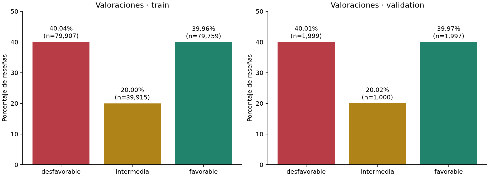
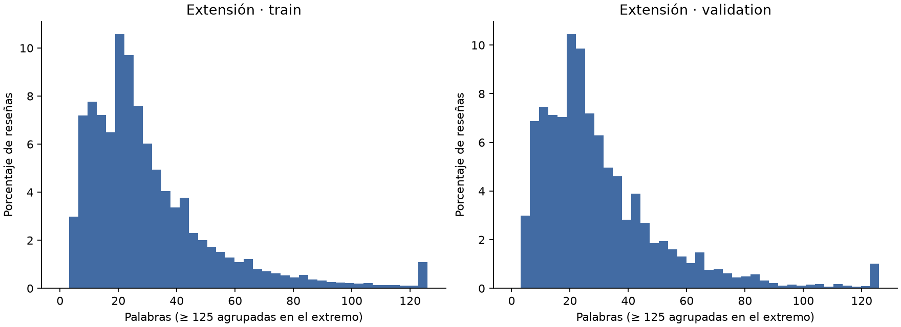
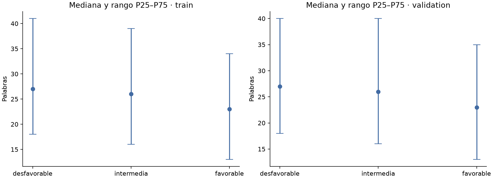
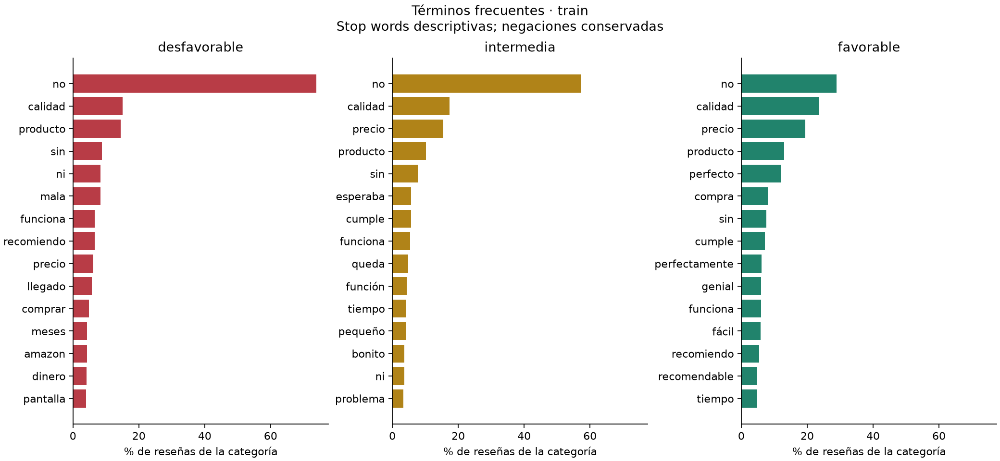
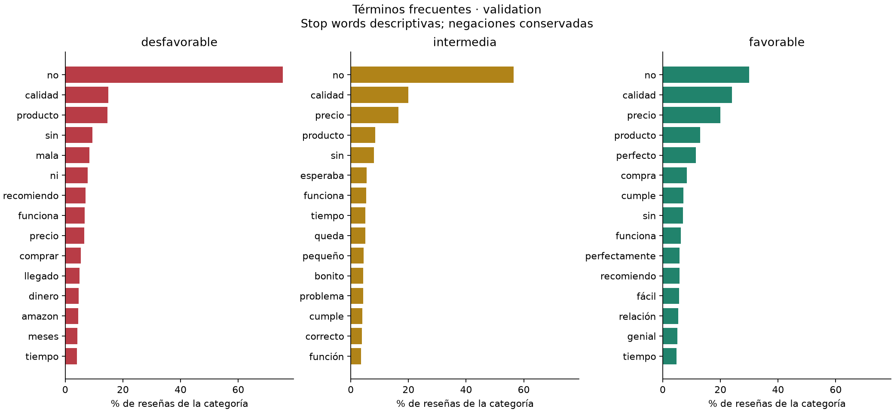

# EDA — Reseñas de productos en español

## Objetivo y datos utilizados

Paso 4, rama `feat/eda`. Se adapta la organización de `01_eda_sid.ipynb` del clasificador de tickets: distribución de clases, faltantes, longitudes, palabras frecuentes, duplicados y muestras. Para este proyecto se exploran solamente entrenamiento y validación de `data/processed/amazon_three_levels_clean/`.

El script [explore_dataset.py](../src/data/explore_dataset.py) verifica sus CSV contra el manifiesto de la auditoría. No abre `test.csv`, no cambia etiquetas ni ajusta vectorizadores o modelos. Las etiquetas describen valoraciones originales agrupadas, no emociones anotadas por personas. El test permanece reservado para evaluar el modelo fijado.

## Reproducción y archivos

Desde la raíz `analizador-opiniones`, con las dependencias del paso 2:

```powershell
& ./opiniones-nlp/.venv312/Scripts/python.exe -m pip install -r opiniones-nlp/requirements-eda.txt
& ./opiniones-nlp/.venv312/Scripts/python.exe opiniones-nlp/src/data/explore_dataset.py
```

La salida debe ser nueva para conservar resultados y anotaciones. Para repetir una ejecución ya existente:

```powershell
& ./opiniones-nlp/.venv312/Scripts/python.exe opiniones-nlp/src/data/explore_dataset.py --output-dir opiniones-nlp/artifacts/eda_v2
```

Salida predeterminada: `opiniones-nlp/artifacts/eda/`.

| Archivo | Contenido |
|---|---|
| `summary.json` | Versiones, parámetros, huellas de datos, política, código y salidas, conteos y comprobaciones. |
| `class_distribution.csv` | Cantidades y porcentajes por clase y conjunto. |
| `length_summary.csv` | Mínimo, máximo, media, desviación poblacional y percentiles de palabras y caracteres por clase. |
| `top_terms.csv` | Veinte términos por clase, conjunto y vista, con frecuencia total y número de reseñas que los contienen. |
| `quality_signals.csv` | Conteos y porcentajes de señales léxicas por clase y conjunto. |
| `review_sample.csv` | Muestra local reproducible con campos vacíos para anotación. |
| Cinco gráficos `.png` | Distribución, histograma de palabras, longitudes por clase y términos de cada conjunto. |

Los CSV, textos de revisión y artefactos originales quedan locales y excluidos de Git. Se versionan los scripts, el notebook sin outputs, las conclusiones y copias de cinco gráficos agregados en `docs/figures/eda/`. No se publican reseñas completas.

Abrir [01_eda_opiniones.ipynb](../notebooks/01_eda_opiniones.ipynb) en VS Code y elegir el intérprete `.venv312/Scripts/python.exe`. El notebook genera el informe si no existe o verifica sus huellas si ya está creado; muestra tablas y gráficos agregados. Para otra ejecución, ajustar su variable `OUTPUT`.

## Distribución y desbalance

| Conjunto | Valoración | Reseñas | Porcentaje |
|---|---|---:|---:|
| `train` | desfavorable | 79.907 | 40,04 % |
| `train` | intermedia | 39.915 | 20,00 % |
| `train` | favorable | 79.759 | 39,96 % |
| `validation` | desfavorable | 1.999 | 40,01 % |
| `validation` | intermedia | 1.000 | 20,02 % |
| `validation` | favorable | 1.997 | 39,97 % |

La clase intermedia reúne aproximadamente una quinta parte de cada conjunto. La razón entre clase mayor y menor es 2,002 en entrenamiento y 1,999 en validación: desbalance cercano a 2:1, coherente con agrupar dos niveles inferiores, uno central y dos superiores. Las proporciones entre conjuntos son muy parecidas; esto no demuestra representatividad de todos los clientes o productos.



## Faltantes, duplicados y coherencia estructural

No se detectaron campos vacíos en las siete columnas de ninguno de los dos CSV, ni identificadores repetidos. Todos los registros conservan la partición y el idioma declarado `es`; sus etiquetas coinciden con el mapeo 0–1, 2 y 3–4 aprobado. Este control no verifica automáticamente el idioma real ni el acuerdo semántico entre texto y valoración.

Hay **cero filas extra con texto exacto normalizado repetido dentro de cada conjunto** y **cero textos normalizados compartidos entre entrenamiento y validación**. La clave usa NFKC, `casefold` y espacios colapsados, como el preparador. La comprobación previa de similitud entre particiones está en [AUDITORIA_SIMILITUD.md](AUDITORIA_SIMILITUD.md); cero duplicados exactos no descarta toda paráfrasis o relación por usuario/producto.

## Longitudes

Las palabras son secuencias de letras Unicode, con apóstrofes internos opcionales, sobre una copia NFKC en minúsculas; cifras y puntuación no cuentan como palabras. No es todavía la tokenización definitiva de NLP. Los caracteres se cuentan sobre el texto original, incluidos espacios, saltos de línea y signos. Los percentiles se calculan con interpolación lineal de pandas.

| Conjunto | Valoración | Media de palabras | P25 | Mediana | P75 | P95 | Máximo |
|---|---|---:|---:|---:|---:|---:|---:|
| `train` | desfavorable | 33,26 | 18 | 27 | 41 | 79 | 500 |
| `train` | intermedia | 32,13 | 16 | 26 | 39 | 78 | 462 |
| `train` | favorable | 28,07 | 13 | 23 | 34 | 71 | 566 |
| `validation` | desfavorable | 32,82 | 18 | 27 | 40 | 75 | 225 |
| `validation` | intermedia | 31,42 | 16 | 26 | 40 | 72 | 263 |
| `validation` | favorable | 28,28 | 13 | 23 | 35 | 69 | 260 |

En los dos conjuntos las medianas son 27 palabras para desfavorables, 26 para intermedias y 23 para favorables. Los intervalos centrales se solapan ampliamente: esta descripción no justifica clasificar solo por extensión. Hay colas largas; entrenamiento llega a 566 palabras y 3.162 caracteres. La tabla completa de caracteres y percentiles está en `length_summary.csv`.

El histograma agrupa valores por encima del P99 de entrenamiento en el extremo derecho; no elimina ni recorta textos del dataset. Ambos conjuntos usan el mismo límite visual.





## Palabras frecuentes y contexto

Se generan dos vistas independientes por conjunto y clase: `raw`, sin filtrar palabras, y `without_stopwords`, utilizando stop words españolas de spaCy, pero protegiendo `no`, `ni`, `sin`, `nunca`, `jamás` y `tampoco`. La lista efectiva, su huella y la versión de spaCy quedan registradas. No se aplican stemming, lematización ni TF-IDF en esta fase.

El orden usa frecuencia documental descendente, frecuencia total descendente y desempate alfabético. El porcentaje indica cuántas reseñas de esa clase contienen el término; repetirlo muchas veces en una sola reseña no aumenta ese porcentaje. Los gráficos usan una escala común entre las tres clases.

`calidad`, `precio` y `producto` aparecen en varias categorías, por lo que una palabra aislada no basta para inferir la valoración. El término `no` aparece en las siguientes proporciones de entrenamiento:

| Valoración | Reseñas que contienen `no` |
|---|---:|
| desfavorable | 73,86 % |
| intermedia | 57,23 % |
| favorable | 28,97 % |

Su presencia incluso en favorables respalda conservar negaciones y examinar contexto; no implica que todas las frases con `no` sean negativas. La vista con stop words es descriptiva: su utilidad para clasificación se comparará posteriormente con validación.





## Señales de revisión y ruido

Una fila puede activar varias señales. Los porcentajes siguientes usan el tamaño del conjunto, sin sumar clases ni señales como si fueran grupos excluyentes.

| Señal | Entrenamiento | % train | Validación | % validation |
|---|---:|---:|---:|---:|
| Hasta 3 palabras | 29 | 0,01 | 1 | 0,02 |
| Sin tokens de letras | 0 | 0,00 | 0 | 0,00 |
| Alguna negación protegida | 113.727 | 56,98 | 2.876 | 57,57 |
| Marcador de contraste | 66.130 | 33,13 | 1.678 | 33,59 |
| Posible enlace | 1 | 0,00 | 0 | 0,00 |
| Posible correo | 0 | 0,00 | 0 | 0,00 |
| Fragmento entre `<` y `>` | 2 | 0,00 | 0 | 0,00 |
| Carácter repetido 5 veces o más | 1.679 | 0,84 | 45 | 0,90 |
| Predominio de mayúsculas | 1.932 | 0,97 | 50 | 1,00 |
| Símbolo Unicode categoría So | 1.125 | 0,56 | 25 | 0,50 |
| Sin stop words españolas en al menos 5 palabras | 141 | 0,07 | 1 | 0,02 |

Un marcador de contraste es `pero`, `aunque` o la secuencia `sin embargo`; puede motivar revisar una opinión mixta, pero no demuestra que lo sea. Predominio de mayúsculas exige al menos diez letras y 70 % de ellas en mayúscula. La categoría Unicode `So` incluye emojis y también otros símbolos; no es un detector completo de emojis. La señal de idioma busca ausencia de stop words, sin identificar automáticamente un idioma.

## Muestra y observaciones cualitativas

Se generaron **47 reseñas distintas**: 30 seleccionadas aleatoriamente (cinco por clase y conjunto), más 17 casos adicionales dirigidos por señales. Se ordenan identificadores antes de muestrear, con semilla 42. Los casos dirigidos se mantienen diferenciados y no sirven para estimar una tasa de errores.

La inspección exploratoria asistida de esta muestra encontró:

- Comentarios sobre calidad y precio del producto, compatibilidad, entrega, embalaje y trato con el vendedor. La valoración global puede referirse a cualquiera de esos aspectos.
- Opiniones que combinan elogios y críticas tanto en intermedias como en favorables y desfavorables. La etiqueta intermedia sigue significando el centro de la escala, sin equivaler a ausencia de emoción.
- Un caso favorable cuyo texto describe una falla y otros casos intermedios con lenguaje satisfecho o enfadado. Son candidatos de desacuerdo texto–valoración, no errores de mapeo demostrados. No se modificaron sus etiquetas.
- Abreviaturas, faltas de tildes, mayúsculas, signos repetidos y símbolos. Normalizar indiscriminadamente puede perder información o unir expresiones distintas.
- Los casos seleccionados por ausencia de stop words seguían siendo textos españoles breves o telegráficos. Los dos fragmentos marcados como parecidos a HTML correspondían a una expresión entre signos y a la notación de una tecla. Estas señales producen falsos positivos y no deben convertirse directamente en reglas de eliminación.

La revisión anterior es una **inspección asistida preliminar**, no una evaluación humana independiente ni una medición de acuerdo entre anotadores. Se completó una copia local `review_annotations.csv` con los cuatro campos y notas individuales de las 47 reseñas, identificando a Codex como revisor IA. El [informe de revisión asistida](REVISION_EDA.md) registra criterios y conteos: 39 compatibles, 6 ambiguas, 1 candidata de discrepancia y 1 insuficiente. No establece tasas de ruido ni valida el idioma de todo el corpus. `review_sample.csv` conserva los campos vacíos como plantilla original; la evaluación humana independiente corresponde al paso 9.

Para hacerlo sin modificar el archivo reproducible:

```powershell
$reviewCopy = 'opiniones-nlp/artifacts/eda/review_annotations.csv'
if (Test-Path -LiteralPath $reviewCopy) { throw 'La copia ya existe; usa otro nombre para conservarla.' }
Copy-Item -LiteralPath 'opiniones-nlp/artifacts/eda/review_sample.csv' -Destination $reviewCopy
```

Completar `reviewer`, `language_observation`, `rating_text_relation` (por ejemplo, compatible, ambigua, discrepante o insuficiente) y `notes`. Mantener las valoraciones originales; las observaciones no se usan automáticamente como nuevas etiquetas de entrenamiento. La evaluación humana independiente del paso 9 seguirá siendo una actividad separada.

## Verificación

```powershell
Set-Location opiniones-nlp
& ./.venv312/Scripts/python.exe -m pytest -q
Set-Location ..
```

Las pruebas del EDA comprueban que funciona sin disponer de `test.csv` y rechazan cualquier intento de abrirlo; validan conteos, mapeo, frecuencias documentales, negaciones, muestras sin anotaciones inventadas, reproducibilidad de CSV, huellas, conservación de fuentes y protección contra sobrescrituras. Se verifican también las etapas anteriores.

## Conclusiones para el paso 5

1. Conservar la agrupación aprobada y documentar que las métricas futuras medirán acuerdo con valoraciones. No convertir intermedia en una supuesta etiqueta neutral.
2. Usar F1 macro y métricas por clase cuando se entrenen los modelos. La clase intermedia tiene aproximadamente la mitad de ejemplos que cada clase extrema; comparar alternativas de ponderación solo en la fase de modelos y con validación.
3. Implementar normalización y tokenización conservando negaciones. Comparar alternativas de stop words y contexto mediante unigramas/bigramas, sin fijar una ganadora por este EDA.
4. Implementar stemming y lematización como alternativas comprobables, con ejemplos de negaciones y opiniones mixtas; no asumir de antemano cuál mejora el clasificador.
5. Conservar fuentes, etiquetas y conjuntos. Revisar URLs, símbolos, signos y supuestos fragmentos HTML antes de decidir reglas; no eliminar automáticamente candidatos por señales débiles de idioma o ruido.
6. Tener en cuenta que casi no hay textos de hasta tres palabras. El comportamiento con entradas muy cortas requerirá comprobaciones específicas; el corpus no cubre bien esos casos.
7. Mantener el test reservado. El siguiente avance se realizará en `feat/preprocesamiento`, después de guardar e integrar este EDA. No se han entrenado modelos ni calculado métricas de clasificación.
